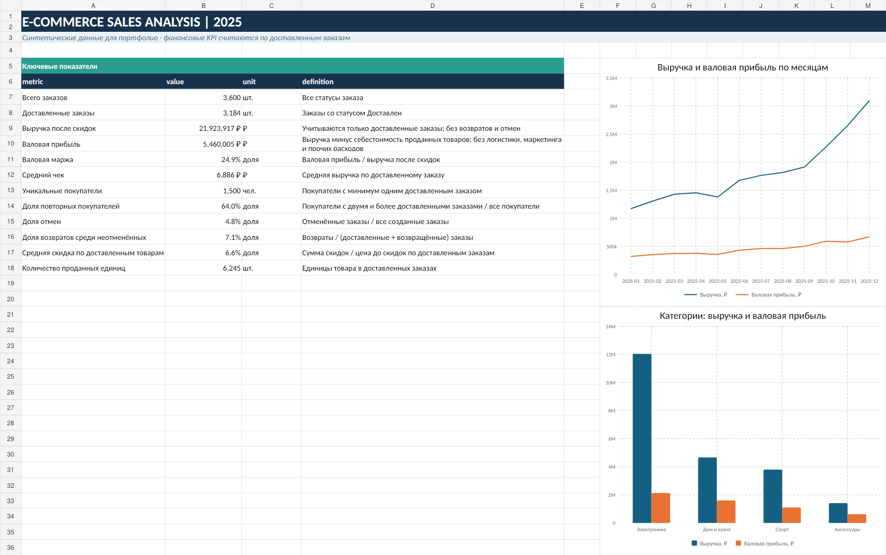

# E-commerce Sales Analysis — 2025

**Учебный проект аналитика данных · SQL · Python · Excel**

> Все данные в проекте синтетические и сгенерированы специально для портфолио. Результаты не описывают реальную компанию или рынок.



## Кратко о проекте

**Бизнес-задача:** понять, какие категории товаров и каналы продаж формируют выручку и валовую прибыль, как показатели меняются в течение года и где могут быть операционные проблемы.

В проекте выполнены проверка качества данных, расчёт бизнес-KPI, анализ динамики по месяцам, сравнение категорий, каналов и регионов, а также подготовлены рекомендации.

### Основные результаты

| Показатель | Результат |
|---|---:|
| Заказы, всего | 3 600 |
| Доставленные заказы | 3 184 |
| Выручка после скидок по доставленным заказам | 21,92 млн ₽ |
| Валовая прибыль | 5,46 млн ₽ |
| Валовая маржа | 24,9% |
| Средний чек доставленного заказа | 6 886 ₽ |
| Доля отмен от всех заказов | 4,8% |
| Доля возвратов среди неотменённых заказов | 7,1% |

### Ключевые наблюдения

- **Электроника** обеспечивает около 54,9% выручки, но её валовая маржа — около 17,7%.
- **Аксессуары** дают меньшую долю выручки, зато их валовая маржа составляет около 44,3%.
- В ноябре и декабре выручка растёт, а валовая маржа снижается примерно до 21,7%; одновременно увеличивается средняя скидка. Это наблюдение для дальнейшей проверки, а не доказательство причинно-следственной связи.
- Пройдены **11 автоматических проверок качества данных**: уникальность ключей, обязательные поля, связи между таблицами, положительное количество, диапазоны скидок и проверки дат.

## Быстрый доступ к материалам

- [Постановка бизнес-задачи](business_task.md)
- [Описание таблиц и полей](data_dictionary.md)
- [Excel-дашборд](ecommerce_sales_dashboard.xlsx)
- [Jupyter Notebook с анализом](notebooks/ecommerce_sales_analysis.ipynb)
- [SQL-запросы](sql/analysis.sql)
- [SQL-схема](sql/schema.sql)
- [Итоговый отчёт](report/analysis_report.md)
- [Результаты проверок качества данных](outputs/data_quality_checks.csv)

## Визуализации

### Выручка и валовая маржа по месяцам


### Выручка и валовая прибыль по категориям


### Выручка по каналам продаж


### Валовая маржа по регионам


## Данные и структура проекта

В проекте используются четыре связанные синтетические таблицы: покупатели, товары, заказы и строки заказов. Всего сгенерировано 1 800 покупателей, 60 товаров, 3 600 заказов и более 5 500 строк заказа.

```text
├── business_task.md                 # бизнес-задача и определения KPI
├── data_dictionary.md                # описание полей и связей
├── ecommerce_sales_dashboard.xlsx    # сводка KPI и графики в Excel
├── data/
│   ├── raw/                           # синтетические CSV-таблицы
│   └── analytics.db                   # база SQLite
├── sql/
│   ├── schema.sql                     # схема таблиц
│   └── analysis.sql                   # аналитические запросы
├── src/
│   ├── generate_data.py               # генератор данных
│   ├── build_database.py              # сборка базы SQLite
│   └── analyze.py                     # анализ, проверки и графики
├── notebooks/ecommerce_sales_analysis.ipynb
├── outputs/                           # рассчитанные KPI и проверки
├── charts/                            # графики и превью дашборда
└── report/analysis_report.md           # аналитический отчёт
```

## Инструменты и методы

- **SQL / SQLite:** `JOIN`, CTE, `GROUP BY`, агрегатные функции, `CASE WHEN`, анализ по месяцам, категориям, каналам и регионам.
- **Python:** `pandas`, `numpy`, `matplotlib` для обработки, расчётов, проверок и визуализации.
- **Excel:** KPI-дашборд, сводные таблицы и графики.
- **Контроль качества данных:** уникальность ключей, пропуски, целостность связей, диапазоны значений и проверка дат.
- **Бизнес-метрики:** выручка после скидок, валовая прибыль, валовая маржа, средний чек, повторные покупатели, отмены и возвраты.

## Как воспроизвести анализ

Требуется Python 3.10 или новее.

```bash
pip install -r requirements.txt
python src/generate_data.py
python src/build_database.py
python src/analyze.py
```

Чтобы открыть ноутбук:

```bash
jupyter notebook notebooks/ecommerce_sales_analysis.ipynb
```

## Определения и ограничения

- Выручка включает только заказы со статусом **«Доставлен»** и считается после скидки.
- Валовая прибыль = выручка после скидки − себестоимость проданных товаров.
- Валовая прибыль здесь **не является чистой прибылью**: в расчёте нет логистики, комиссий, маркетинговых и прочих операционных расходов.
- Без данных о трафике и рекламных затратах нельзя корректно рассчитать конверсию в заказ, CAC или ROAS.
- Данные и обнаруженные закономерности синтетические; они демонстрируют подход к анализу, но не подтверждают реальные рыночные факты.
- Проект показывает учебный процесс аналитической работы и не является заявлением о коммерческом опыте аналитика.
