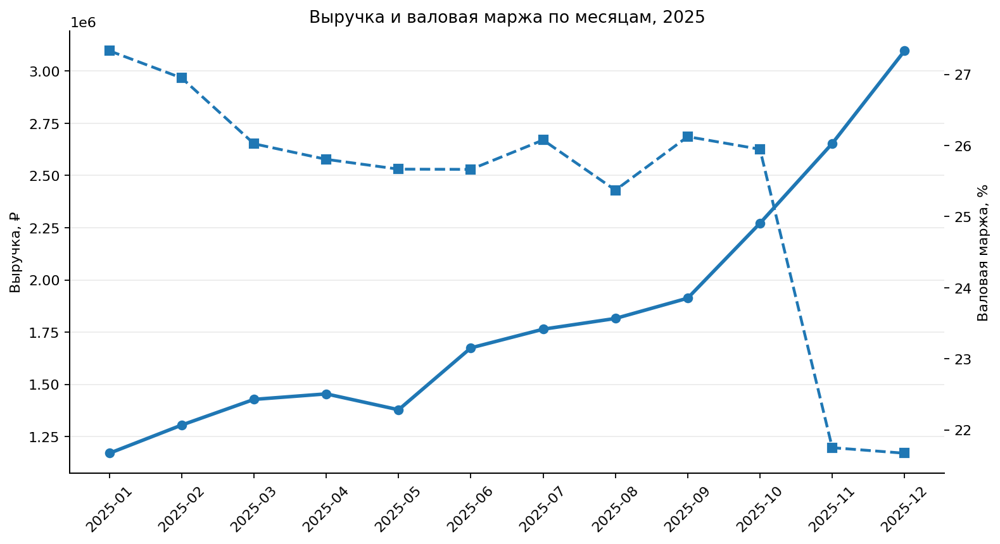
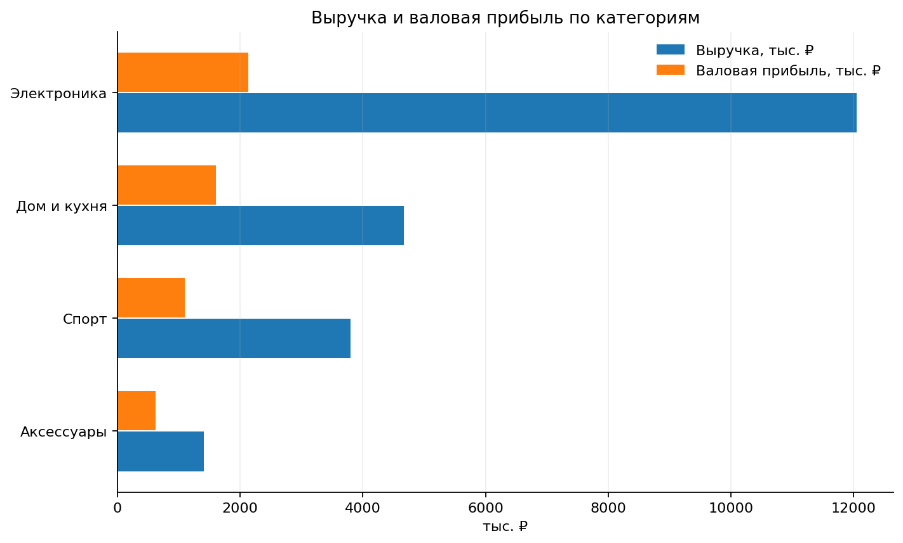
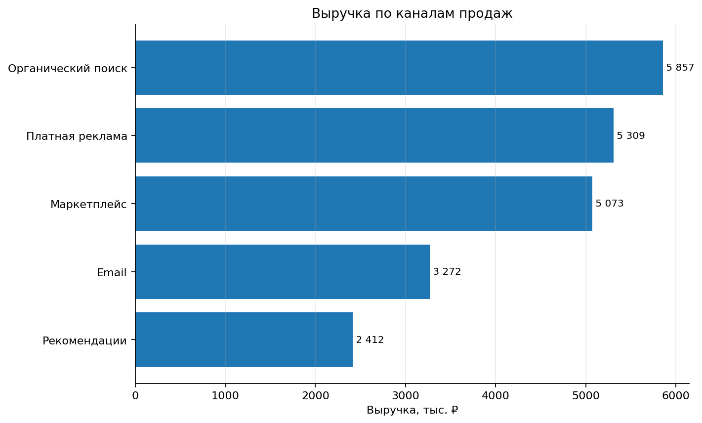
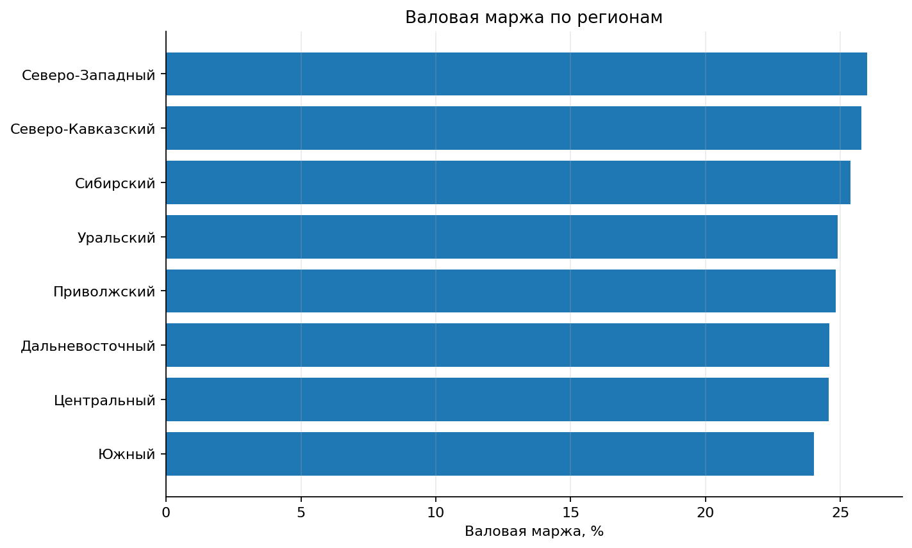

# E-commerce Sales Analysis — 2025

**Учебный проект аналитика данных · Синтетические данные · SQL + Python**

> Все данные в проекте сгенерированы специально для портфолио. Это не данные реальной компании и не основание для выводов о реальном рынке.

## Бизнес-задача

Руководитель интернет-магазина хочет понять, какие товарные категории и каналы формируют выручку и валовую прибыль, как показатели меняются в течение года и где могут скрываться операционные проблемы. Аналитику нужно проверить качество данных, посчитать основные KPI и подготовить рекомендации для бизнеса.

Полная формулировка: [`business_task.md`](business_task.md).

## Главные результаты синтетического кейса

- **3 600 заказов**, из них **3 184 доставленных**.
- **21,92 млн ₽** выручки после скидок по доставленным заказам.
- **5,46 млн ₽** валовой прибыли; валовая маржа — около **24,9%**.
- Средний чек доставленного заказа — около **6 886 ₽**.
- Доля отмен от всех заказов — около **4,8%**.
- Доля возвратов среди неотменённых заказов — около **7,1%**.
- Категория «Электроника» формирует примерно **55%** выручки, но показывает валовую маржу около **17,7%**. У категории «Аксессуары» маржа существенно выше — около **44,3%**, но доля выручки заметно ниже.
- В ноябре и декабре выручка растёт вместе с объёмом заказов, а валовая маржа падает примерно до **21,7%**. Это совпадает с более высокими скидками в пиковые месяцы. На синтетических данных можно показать гипотезу, но это не доказывает причинность.
- Пройдены **11 автоматических проверок качества данных**: дубликаты ключей, пропуски в обязательных полях, целостность связей, положительное количество и допустимость скидок.

Числа могут быть воспроизведены запуском скриптов из репозитория; небольшие отличия возможны, если изменять seed или параметры генератора.

## Что внутри

```text
├── business_task.md             # постановка задачи и определения KPI
├── data_dictionary.md            # описание полей и связей
├── ecommerce_sales_dashboard.xlsx # Excel-сводка KPI, месяцы, категории, каналы, регионы
├── data/
│   ├── raw/                      # 4 исходные синтетические CSV-таблицы
│   └── analytics.db              # SQLite база для выполнения SQL
├── sql/
│   ├── schema.sql                # структура таблиц
│   └── analysis.sql              # SQL-запросы к бизнес-вопросам
├── src/
│   ├── generate_data.py          # воспроизводимая генерация данных
│   ├── build_database.py         # сборка SQLite базы
│   └── analyze.py                # проверки, расчёты, графики и отчёт
├── notebooks/
│   └── ecommerce_sales_analysis.ipynb
├── outputs/                      # KPI-таблицы и проверки качества
├── charts/                       # итоговые визуализации
└── report/
    └── analysis_report.md        # краткий аналитический отчёт
```

## Excel-сводка

В `ecommerce_sales_dashboard.xlsx` есть лист Dashboard с KPI и графиками, а также отдельные листы с помесячными метриками, категориями, каналами, регионами, товарами и проверками качества данных.

## Технологии

- **SQL (SQLite):** `JOIN`, агрегатные функции, CTE, группировки, `CASE WHEN`, метрики по месяцам/категориям/каналам/регионам.
- **Python:** `pandas`, `numpy`, `matplotlib` для подготовки, расчётов, проверок и графиков.
- **Data quality:** проверки уникальности ключей, ссылочной целостности, пропусков и диапазонов значений.
- **Бизнес-аналитика:** выручка после скидок, валовая прибыль, валовая маржа, средний чек, повторные покупатели, отмены и возвраты.

## Как запустить

Рекомендуется Python 3.10+.

```bash
pip install -r requirements.txt
python src/generate_data.py
python src/build_database.py
python src/analyze.py
```

Чтобы открыть ноутбук:

```bash
jupyter notebook notebooks/ecommerce_sales_analysis.ipynb
```

SQL-запросы можно выполнить в SQLite через `data/analytics.db` после запуска сборки базы.

## Визуализации

### Выручка и валовая маржа по месяцам



### Выручка и валовая прибыль по категориям



### Выручка по каналам



### Валовая маржа по регионам



## Ограничения и честная интерпретация

- Аналитика охватывает синтетические заказы за 2025 год.
- Выручка считается только по заказам со статусом `Доставлен`.
- Валовая прибыль здесь = выручка после скидки − себестоимость товара. Она **не** включает логистику, комиссии, маркетинг и прочие операционные затраты; это не чистая прибыль.
- Без рекламных расходов и данных о трафике нельзя корректно считать CAC, ROAS или конверсию в заказ.
- Категории, каналы и регионы различаются по масштабу, поэтому для управленческих решений нужно сравнивать и абсолютные значения, и удельные метрики.
- Портфолио демонстрирует процесс аналитической работы, а не коммерческий опыт аналитика в реальной компании.

## Следующие улучшения

- Добавить в дашборд фильтры по месяцу, каналу и категории.
- Проверить устойчивость выводов к альтернативным определениям возврата и выручки.
- Добавить расходы на маркетинг и логистику в будущую версию модели, чтобы считать маржинальную прибыль по каналам.
